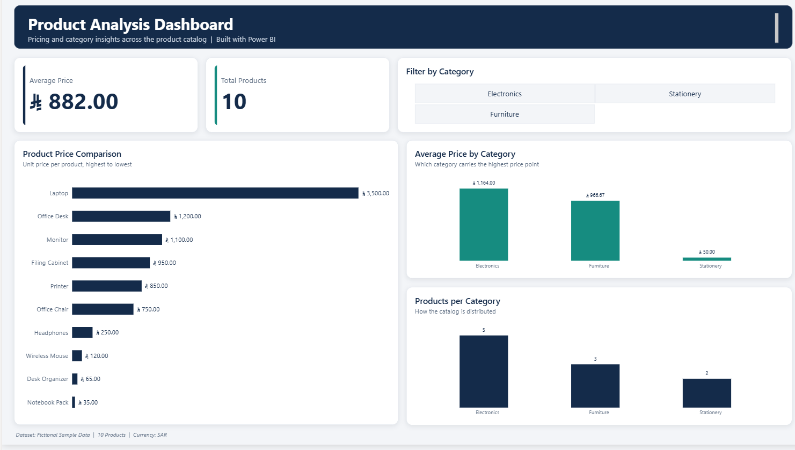

# Product Analysis Dashboard | SQL & Power BI

## Project Overview

This project focuses on analyzing a sample product dataset using SQL and Microsoft Power BI.

The goal was to explore product prices and categories, calculate key performance metrics, and build an interactive dashboard to present the results in a clear and visual way.

## Project Objectives

- Analyze product data using SQL.
- Explore product prices and categories.
- Calculate key summary statistics.
- Compare average prices across product categories.
- Build an interactive dashboard using Power BI.

## Tools & Technologies

- SQL (SQLite)
- SQLiteOnline
- Microsoft Power BI Desktop
- GitHub

## Dataset

The project uses a fictional dataset containing 10 products with the following fields:

- Product ID
- Product Name
- Category
- Price

**Note:** The dataset is fictional and was created for educational and portfolio purposes. It does not represent actual company sales or revenue.

## SQL Analysis

The SQL analysis covers:

- Filtering products by price and category.
- Sorting products by price.
- Counting total products.
- Calculating average, highest, and lowest prices.
- Counting products by category.
- Calculating average prices for each category.

## Key Findings

- Total products: 10
- Average product price: 882 SAR
- Highest product price: 3,500 SAR
- Lowest product price: 35 SAR

### Products by Category

| Category | Product Count |
|---|---:|
| Electronics | 5 |
| Furniture | 3 |
| Stationery | 2 |

### Average Price by Category

| Category | Average Price (SAR) |
|---|---:|
| Electronics | 1,164 |
| Furniture | 966.67 |
| Stationery | 50 |

## Power BI Dashboard

The interactive dashboard includes:

- Total Products KPI.
- Average Price KPI.
- Product Price Comparison.
- Average Price by Category.
- Products by Category.
- Interactive Category Filter.

## Dashboard Preview

## Key Insights

- Electronics represents half of the products in the dataset.
- Electronics has the highest average product price.
- Furniture has the second-highest average price.
- Stationery has the lowest average product price.

## Project Files

- [SQL Analysis](sql/01_product_analysis.sql)
- [Product Dataset](products.csv)
- [Power BI Dashboard](product_analysis_dashboard.pbix)

## Future Improvements

- Expand the dataset with sales transaction records.
- Analyze sales quantities and revenue.
- Explore monthly and yearly sales trends.
- Develop more advanced business performance insights.

## Project Status

**Completed – Initial Product Analysis Phase**

---

Created as a personal learning and portfolio project.
